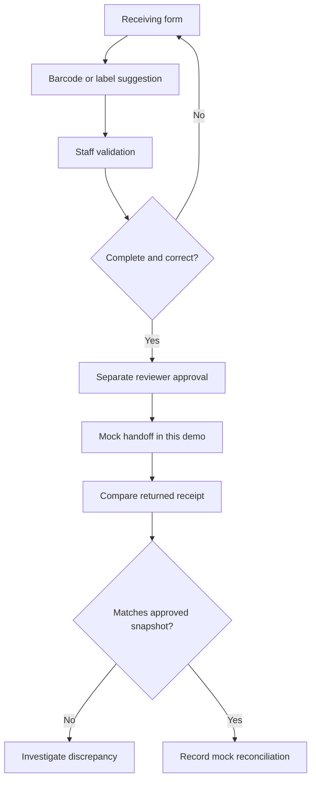

# Harvest Hope receiving assistant

An internal V1 repository for reviewing how a digital receiving form, catalog lookup, optional small-model assistance, and staff approval could work together at a food bank.

**Status: local demonstration with synthetic data.** This repository does not establish that an AI receiving product has been deployed at Harvest Hope. It does not connect to iBlueprint, WAERlinx, or NetSuite, and it does not write inventory. The warehouse handoff and reconciliation are explicitly simulated.

## The problem and the people

Receiving staff must record what arrived, identify the correct item and unit, measure quantities and weights, and resolve exceptions. A suggested product match helps only if it saves work without introducing a bad record. This draft makes those decisions visible and keeps staff responsible for accepted information.

Harvest Hope already uses a conventional digital receiving form and separate AI tools, according to the project brief. Project planning notes describe possible iBlueprint workflows and a receiving pilot. This repository implements a new demonstration around those ideas; it is not a copy of the existing form or of proprietary iBlueprint code. See [sources and decisions](docs/sources-and-decisions.md).

## What works in this draft

- Save and edit receipt drafts, with catalog items, quantities, units, weights, lot numbers, and expiry dates.
- Look up synthetic UPC/EAN identifiers and make conservative suggestions from typed label text. These deterministic rules are **not AI or OCR**.
- Run an optional command-line Tesseract OCR check on the three synthetic label images, then match the extracted names against the catalog. This is separate from browser photo upload.
- Request optional local-model text matching through an explicitly configured Ollama service. The default makes no model calls.
- Keep suggestions separate from entries, require staff checks, and require a different reviewer to approve a receipt.
- Preserve versions and an audit trail; edits revoke approval, and handed-off records become immutable.
- Simulate an idempotent handoff and compare its returned receipt with the approved snapshot.
- Attach JPEG/PNG evidence locally, strip metadata, and enforce configured retention. The app does not analyze photos or derive quantities from them.
- Run repeatable synthetic evaluations and tests without vendor credentials.

The included text comparison covers 62 authored cases. The separate OCR check actually ran on three synthetic label images and produced three correct item suggestions. Those tiny, different datasets do not establish warehouse-photo accuracy. No Ollama language-model inference has been run, and staff time and operating cost remain unmeasured. A blank observation template and summarizer are included for a later study.

## Run locally

Use Python 3.11 or later from the repository root. The first dependency installation requires package-network access.

```bash
python -m venv .venv
source .venv/bin/activate
python -m pip install -r requirements.txt
python -m receiving
```

On Windows, replace the activation command with `.venv\Scripts\activate` in Command Prompt or `.venv\Scripts\Activate.ps1` in PowerShell. Open [http://127.0.0.1:8000](http://127.0.0.1:8000).

Choose the **Receiver** demo identity to create and submit a receipt. Switch to **Reviewer** to approve it, run the mock handoff, and inspect reconciliation and audit events. The identity selector demonstrates permissions; it is not a sign-in system. Use the supplied synthetic sample receipts and labels. See the [demo walkthrough](docs/demo-walkthrough.md).

```bash
python -m unittest discover -s tests -v
python scripts/demo_walkthrough.py
python -m evaluation.run
python -m receiving.maintenance purge-expired-photos
```

If Tesseract and its English language data are already installed, the separate OCR check can be repeated with `python -m evaluation.ocr_run`. It downloads nothing. The observation template and optional model-run instructions are in [evaluation/README.md](evaluation/README.md).

Configuration and the optional local-model setup are documented in [deployment](docs/deployment.md). Read the evaluation's [method and limits](evaluation/README.md) before quoting results. [Verification](docs/verification.md) records completed tests and the browser checks still pending.

The scripted walkthrough runs receipt capture, review, mock handoff, mismatch and recovery in a temporary database without a browser or network. [Verification notes](docs/verification.md) record the checks actually completed and those still pending.

## The intended workflow



For a future real integration, an approved receipt would be handed to WAERlinx under a validated contract, followed by confirmation of the existing WAERlinx–NetSuite exchange. NetSuite purchase-order preparation remains a separate prerequisite. See [architecture](docs/architecture.md) and [integration boundaries](docs/integrations.md).

## Repository guide

| Location | Purpose |
| --- | --- |
| `receiving/` | Application, validation, storage, matching, optional AI adapter, and web interface |
| `data/synthetic/` | Invented catalog, receipt fixtures, label images, and evaluation examples |
| `evaluation/` | Reproducible comparison and reporting; no invented staff-time savings |
| `tests/` | Receiving controls, persistence, matching, and evaluation checks |
| `contracts/` | This project's data contracts; not vendor API schemas |
| `workflows/` | Conceptual orchestration specification; not a native iBlueprint import |
| `docs/` | Data definitions, privacy, model cards, pilot plan, and operational limits |

## Checklist coverage

| Requested checklist item | Included here |
| --- | --- |
| Problem, users, installation, current status | This README and [walkthrough](docs/demo-walkthrough.md) |
| Annotated workflow | [Architecture](docs/architecture.md), [integration boundaries](docs/integrations.md), and `workflows/receiving.workflow.json` |
| Source and configuration without secrets | `receiving/`, root configuration example, [licensing](LICENSE), and [third-party notices](THIRD_PARTY_NOTICES.md) |
| Sample forms, product data, images, expected answers | `data/synthetic/` and [data provenance](docs/data-provenance.md) |
| Comparison of form, barcode/OCR, and small-model approaches | [Text comparison](evaluation/results/report.md), [separate OCR check](evaluation/results/ocr_report.md), optional model adapter, and [observation protocol](evaluation/README.md); model performance and human time/cost are unmeasured |
| Data dictionary, model cards, privacy, audit, failure handling | [Data dictionary](docs/data-dictionary.md), [model cards](docs/model-cards/README.md), [privacy](docs/privacy-and-retention.md), and [failure handling](docs/failure-handling.md) |
| Limits, deployment, accessibility, license, contribution/contact | [Limits](docs/known-limitations.md), [deployment](docs/deployment.md), [accessibility](docs/accessibility.md), [LICENSE](LICENSE), [CONTRIBUTING](CONTRIBUTING.md), and [SECURITY](SECURITY.md) |

## Before a real pilot

The next decision is whether the receiver and reviewer can use this workflow comfortably with representative work. A proposed pilot is described in [pilot and acceptance](docs/pilot-and-acceptance.md). The real form, item master, API permissions, model choice, identity provider, retention policy, and support owner still need to be agreed. This draft makes no food-safety determination and does not create new catalog items automatically.

## License and contact

This is a private review draft with a proposed MIT license for original project material. Public release and ownership must be confirmed before that license is activated. Vendor products, partner records, and model weights are not relicensed by this repository. Report ordinary issues to the project owner in the existing project workspace; do not put operational records or credentials in public issues.
