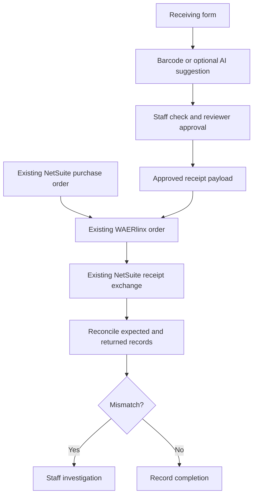
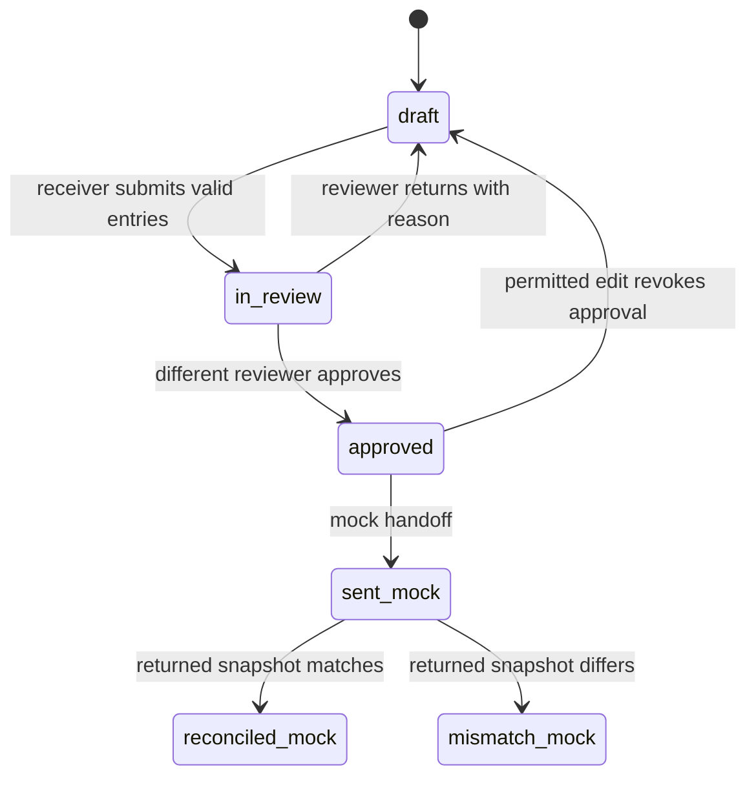

# Architecture and receiving controls

## Scope

The application is a local Python service with a web interface and SQLite persistence. It manages receipt drafts and simulated transfers, not stock balances. It has no live warehouse or financial system credentials.

The design starts with a conventional form and barcode lookup. Label rules or an optional local model may suggest a catalog item. The receiver measures and enters the actual quantity; the reviewer approves the checked record. A suggestion never establishes hidden case counts, measured weight, expiry, lot identity, or food safety.

## Components

| Component | Responsibility | Boundary |
| --- | --- | --- |
| Web form | Capture entries, display suggestions and issues, request review | Does not silently accept a suggestion or bypass server checks |
| Application service | Validate data, enforce role and state rules, manage versions | Every mutation is checked server-side |
| Synthetic catalog | Known items, units, aliases, required fields | Demo identifiers have no operational authority |
| Matching | Exact barcode lookup and conservative label rules | Abstains when no supported unique match exists |
| Optional Tesseract CLI | Extract text from local synthetic label images for a separate evaluation | No browser OCR endpoint; bounded local subprocess, not vision inference or counting |
| Optional Ollama adapter | Suggest a catalog item from bounded text | Explicit configuration; no automatic model download; no inventory permission |
| SQLite and local files | Receipts, versions, event records, handoffs, photo evidence | Single-host demonstration; not a multi-tenant service |
| Mock warehouse adapter | Persist a simulated handoff and receipt response | Never calls WAERlinx or NetSuite |

## Proposed integration sequence

The WAERlinx and NetSuite boxes describe the proposed external sequence, not an implemented integration. The 2023 source manual says a donated-product purchase order is prepared in NetSuite, then received and put away in WAERlinx. Validate this against current practice. A phone draft is not a purchase order, a warehouse receipt, or available stock.

The optional OCR CLI is an evaluation aid outside this live form sequence. It runs only when invoked and when the local Tesseract executable and English language data are available. Uploaded browser photos remain evidence attachments.

## Record lifecycle

An `expected_version` is required for changes to an existing receipt. If another operation has changed the version, the service rejects the stale write rather than overwriting the newer record. After handoff, the approved receipt is frozen. Production correction and reversal workflows are outside V1; do not edit a sent record to make a mismatch disappear.

## Approval and replay protection

An approval records the reviewer and the specific receipt revision. Changes before handoff clear the approval. Server-side validation is repeated at the transition, so a client cannot approve invalid entries by skipping a UI step.

The handoff has a caller-generated idempotency key and a saved approved snapshot. Repeating a successful request with the same key and the same payload must return the prior result. A key reused with different content is a conflict. Idempotency prevents a retry of one request from making another simulated receipt; it does not replace reconciliation or real vendor transaction identifiers.

`delivery_ref` identifies a physical delivery, not its purchase order. Several deliveries may refer to one purchase order. The implemented uniqueness key is the case-normalized combination of warehouse, supplier, and delivery reference. Confirm that this rule fits operational identifiers before importing real records.

## Audit evidence

Events retain an action, actor identifier, timestamp, original or changed values, and a hash linked to the previous event. The application verifies the chain. A valid chain is evidence of internal consistency, not proof against a database administrator who can rewrite the entire chain. A real service needs access controls, backups, independent logs, and approved retention rules.

Read [failure handling](failure-handling.md), [privacy](privacy-and-retention.md), and [integration boundaries](integrations.md) before changing these controls.
